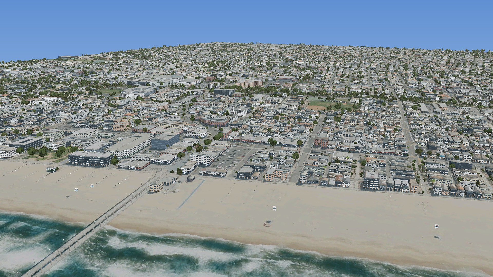
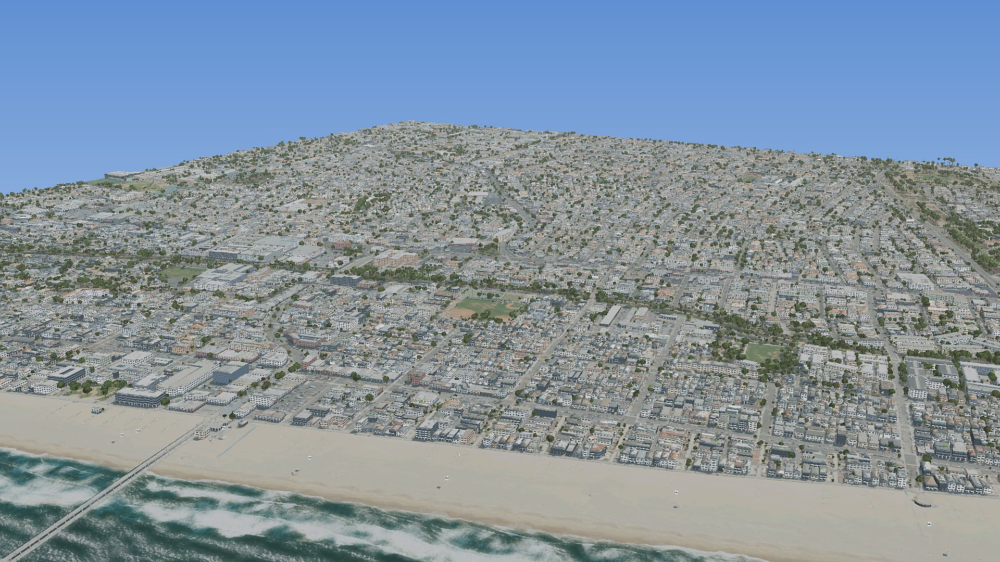
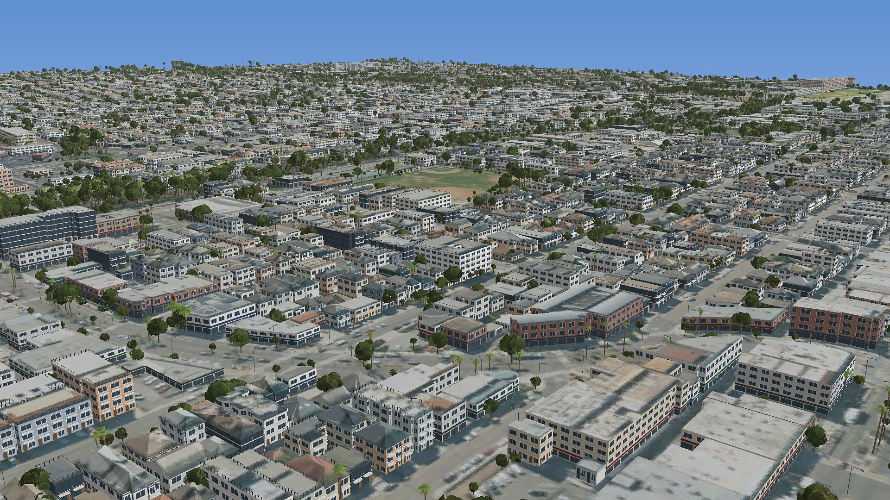
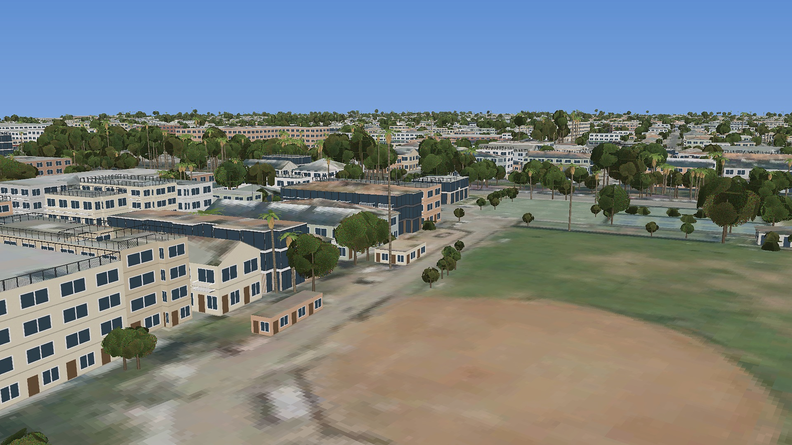
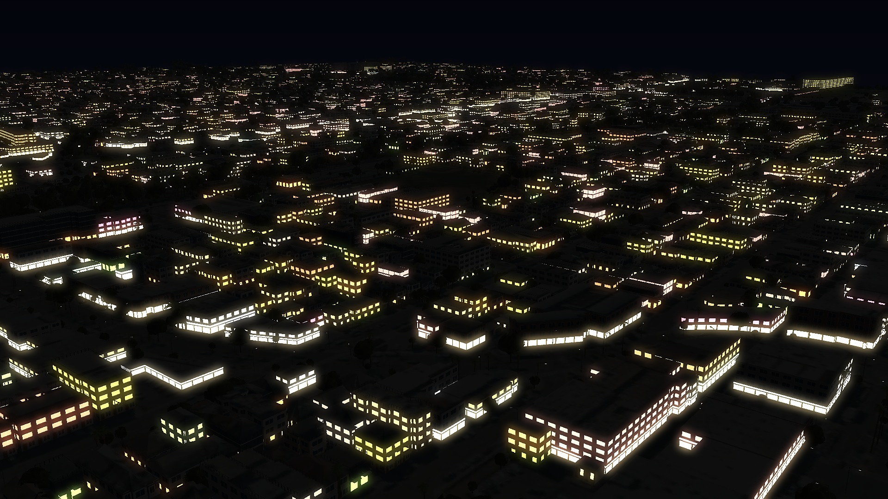
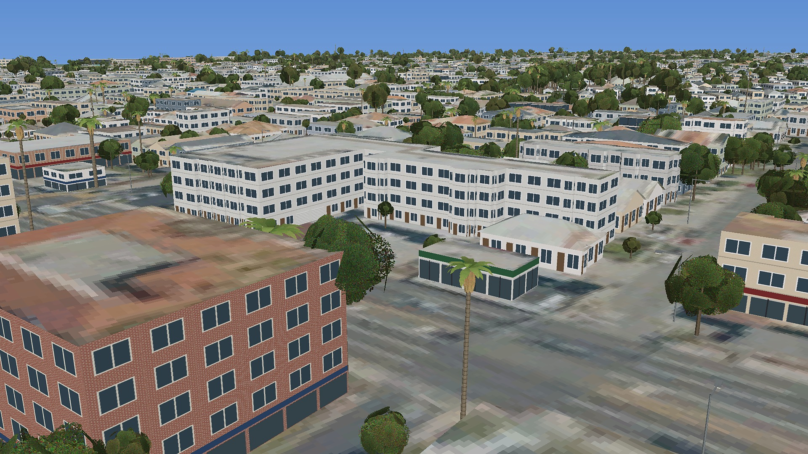
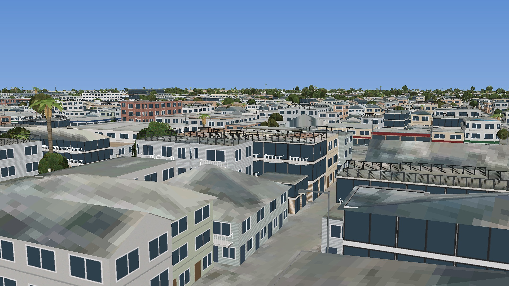

# Hermosa Beach Photoreal: X-Plane scenery

A photoreal overlay scenery pack for **Hermosa Beach, California** for X-Plane 11 and 12.
It replaces the default, misaligned scenery with:

| Feature | How |
|---|---|
| **Aerial photo ground** | USDA NAIP imagery (public domain, ~0.6 m) is draped over the whole city, the beach, the surf zone and the pier. It fades into X-Plane's own water about 650–900 m offshore. |
| **Roads and beach aligned to the photo** | Exclusion zones remove X-Plane's default roads, beaches, autogen, forests and objects inside the area. The roads and sand you see are the ones in the photo, so they line up exactly. |
| **3D buildings that match reality** | Every building is extruded from its real footprint and real height. In Hermosa Beach these come from the LA County LARIAC building import in OpenStreetMap: outlines traced from 4-inch aerial imagery, heights from LiDAR. Roofs are textured with the aerial photo itself. Walls use a generated stucco/storefront/glass atlas with lit windows at night. |
| **Roof shapes** | Each house's roof is read off the aerial photo: a pitched roof shows a sun-lit half and a shaded half, and red clay tile is always pitched. Pitched roofs are built as real gable or hip roofs with eave overhangs, with the measured height as the ridge and the walls ending at the eaves. They work on any footprint shape, not just rectangles. OSM `roof:shape` tags override the detection. |
| **Wall variety** | Stucco, clapboard siding, modern (big glass, dark frames, wood slats), brick and storefront façades. Modern boxes are more common near the beach. Garage doors appear on walls facing an alley, balconies with railings on ocean-facing walls of beach-area homes, and cable-railed roof decks on flat-roofed homes near the sand. |
| **Beach** | 3D LA County-style lifeguard towers (on stilts, facing the water, ramp behind) and beach volleyball nets, placed from OpenStreetMap and, when reachable, LA County's lifeguard tower layer. |
| **Hermosa Beach Pier** | Built in 3D from its OSM outline: a photo-textured deck on concrete pilings, with lamps along both rails. |
| **Trees** | About 36,000 real trees from LA County's 2023 tree-tops dataset (LARIAC7: LiDAR heights plus 4-inch infrared imagery), each placed where it actually stands, at its measured height and crown size. Tall trees with small crowns become palms (Mexican fan or Canary date); the rest are broadleaf trees and shrubs. If that dataset is unavailable, trees are detected from NAIP's near-infrared band instead. Trees mapped in OSM with a genus are added too. |
| **Street lights** | Cobra-head lights along every road (staggered or both sides depending on road class), acorn lamps on pedestrian ways and the pier. They glow at night. If OSM has real lamp positions, those are used instead. |
| **Traffic (optional pack)** | `zzz_Hermosa_Beach_0_Traffic` lays X-Plane's own road network (moving cars, X-Plane street lighting) on every OSM street. **Experimental:** the road type numbers come from Laminar's road generator source and couldn't be checked in X-Plane 12. If roads look wrong, delete that folder. |



| | |
|---|---|
|  |  |
|  |  |
|  |  |

*These are software renders of the real built pack, from `tests/render_view.py` (flat terrain, no shadows). They approximate the in-sim look and are not X-Plane screenshots.*

Coverage: 33.849°N–33.876°N, 118.414°W–118.374°W (Manhattan Beach line to Herondo St, Strand to PCH and beyond). You can change this in [`config.toml`](config.toml).

## Getting the pack

### Option A: download a build from GitHub (easiest)

1. Go to **Actions → Build scenery pack → Run workflow** (pick `naip`, zoom `18`).
2. When it finishes (~10–20 min), open **Releases**. Download `zzz_Hermosa_Beach_Photoreal.zip`, plus `preview.jpg` and `render_check.jpg` if you want to check the result first.

### Option B: build it yourself

You need Python 3.11+ and an internet connection.

```bash
pip install -r requirements.txt
python -m hxp all          # fetch OSM + imagery, download DSFTool, build
```

Steps can also be run one at a time: `fetch-osm`, `fetch-imagery`, `tools`, `build`.
The output goes to `build/zzz_Hermosa_Beach_Photoreal/` (plus a `.zip`). `build/preview.jpg` overlays the building footprints and the coastline on the photo, so you can check the alignment.

## Installing

1. Unzip or copy `zzz_Hermosa_Beach_Photoreal` into `X-Plane 12/Custom Scenery/`.
2. Start X-Plane once. It adds the pack to `Custom Scenery/scenery_packs.ini`.
3. The pack must sit **above** any Ortho4XP or mesh packs in that file, and above `*GLOBAL_AIRPORTS*`. New packs are added at the top, so this is usually automatic.
4. Fly from KTOA (Torrance) or KLAX. Hermosa Beach is about 4 nm north of KTOA.

## How it works

```
OSM (Overpass) ─┬─ buildings (footprint + height) ──► one OBJ8 per building, roof UV = photo
                ├─ coastline ──► land polygon ──► photo alpha mask + drape extent
                └─ pier ──► deck + pilings OBJ8
NAIP imagery ───► 4096² DDS textures (photo on top, wall atlas in the bottom 512 rows)
                  draped .pol polygons with per-vertex UVs
                  ─────────────────────────────────────────────►  DSF text ─► DSFTool ─► +33-119.dsf
```

* `hxp/osm.py`: Overpass download, multipolygon assembly, coastline → land polygon
* `hxp/imagery.py`: Web-Mercator chunk grid, NAIP / XYZ download
* `hxp/ortho.py`: alpha mask, draped polygons, `.pol` files
* `hxp/buildings.py`: OBJ8 extrusion (earcut roofs, bay-subdivided walls, basements for slopes)
* `hxp/textures.py`: wall atlas, night-lighting texture, mipmapped DXT1/DXT5 DDS writer
* `hxp/dsf.py`: DSF text, DSFTool download/compile/verify
* `tests/make_synthetic.py` and `tests/render_check.py`: offline end-to-end test and software renderer

Each building is its own object, placed at its centroid. X-Plane then sets it on the terrain at the right elevation, even on Hermosa's hills, and walls continue a few metres below ground so nothing floats.

## Tuning (`config.toml`)

* **Higher-res photo:** set `source = "arcgis"`, `arcgis_url` to an ArcGIS `.../ImageServer/exportImage` (or `.../MapServer/export`) endpoint, and `zoom = 20` (~0.12 m/px). LA County's LARIAC 4-inch orthophotos are the best source for Hermosa Beach. Or set `zoom = 19`, `source = "xyz"` and an `xyz_url`. The default URL is Esri World Imagery. Check the provider's licence: most forbid redistribution, so keep such builds for personal use. NAIP is public domain.
* **Photos upside down in the sim?** Set `dds_flip = false`, or use `texture_format = "png"`.
* **Too much photo over the ocean?** Lower `sea_opaque` / `sea_fade`.
* **3D road network with traffic and streetlights (experimental):** set `[roads] enabled = true` and map OSM `highway` values to road type numbers from your X-Plane's `Resources/default scenery/1000 roads/roads.net`.

## Sharper imagery (to do)

The photo is currently USDA NAIP at ~0.5 m/px. Switching to sharper imagery only needs settings in `config.toml`; nothing else changes (roofs pick up the new photo automatically).

* **LA County LARIAC (10 cm, 2023).** The best source, and its [terms of use](https://egis-lacounty.hub.arcgis.com/pages/terms-of-use) allow redistribution (no endorsement implied). The County's public map loads it through an EagleView service with an embedded key, which isn't meant for bulk download. Request the imagery, or an approved service URL, from LA County eGIS / LARIAC. Then set `source = "arcgis"` with `arcgis_url` (or `"xyz"` with a tile URL) and `zoom = 20`.
* **Esri World Imagery (~0.3 m), personal use only.** Set `source = "xyz"` (the default `xyz_url` is Esri) and `zoom = 19`, and run `python -m hxp all` on your own PC. Don't publish the result.

## Known limitations

* Roof shapes are inferred from 0.5 m imagery, so some roofs get the wrong type. Complex roofs (dormers, multi-level) are simplified to one gable or hip.
* Wall textures are generic Hermosa-style façades. They are not photos of each building's façade.
* In this release the roads are the photo roads. The default 3D road network (cars, streetlights) is removed inside the area unless you enable the experimental OSM road network.

## Credits and licences

* Code: MIT.
* Tree positions and heights: County of Los Angeles, LARIAC7 Tree Canopy Tops 2023, used under the [LARIAC terms of use](https://egis-lacounty.hub.arcgis.com/pages/terms-of-use). No endorsement by the County is implied.
* Map data © OpenStreetMap contributors, [ODbL](https://www.openstreetmap.org/copyright). The building data originates from LA County LARIAC.
* NAIP imagery: USDA Farm Production and Conservation Business Center, public domain.
* DSFTool: Laminar Research xptools, downloaded at build time.
